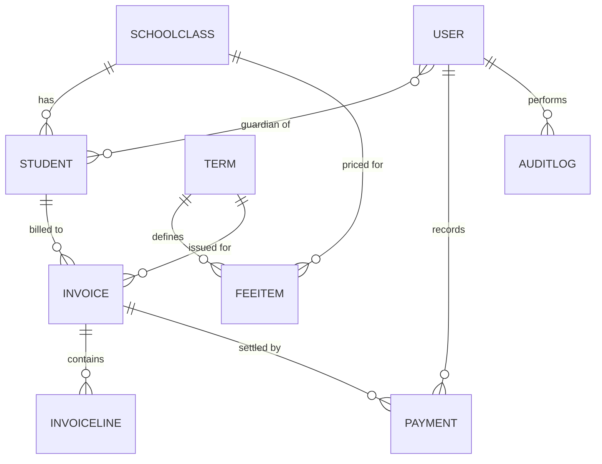

# School Fees Manager

A full-stack fee management system for schools: student accounts, term invoices, payments, statements and role-based access for admins, accountants and parents.

> **Source code is private.** This repo is a showcase: screenshots, architecture and design decisions. I'm happy to walk through the code live or share access on request (contact below).

**Status:** in active development. The core flows below are built and tested; payment integrations and reporting are on the roadmap.

---

## Screenshots

| Sign in | Dashboard |
|---|---|
|  |  |

| Invoices | Record payment |
|---|---|
|  |  |

| Fee structure setup | Void payment (with audit trail) |
|---|---|
|  |  |

| Parent portal: statement |
|---|
|  |

| Automated tests passing | Commit history (private repo) |
|---|---|
|  |  |

_All data shown is fictional._

---

## Features

**Admin**
- Set up terms, classes and the fee structure per class and term
- Add students individually or import them from CSV (all-or-nothing, with row-level error messages)
- Create accounts for accountants and parents (no open signup)
- Generate invoices for a whole class in one action, with no duplicates if run twice
- Void payments with a mandatory reason, and review a full audit log

**Accountant**
- Record payments (M-Pesa, bank, cash, cheque) against outstanding invoices
- Dashboard of billed, collected and outstanding amounts, with collection rate per class
- Search and filter invoices by status (paid, partial, unpaid)

**Parent**
- See only their own children
- View a statement per child with a running balance

---

## Tech stack

| Layer | Technology |
|---|---|
| Backend | Python, Django, Django REST Framework |
| Auth | JWT (SimpleJWT) with rotating refresh tokens in an httpOnly cookie |
| Database | Microsoft SQL Server via `mssql-django` (developed and tested on SQLite) |
| Frontend | React 18, Vite, Tailwind CSS, Axios |
| Testing | Django `APITestCase`, Vitest + React Testing Library |

---

## Data model

---

## Design decisions

The interesting part of a fees system is that it handles money, so the design leans on correctness over cleverness.

- **Exact money.** All amounts are `Decimal`, never floats.
- **Nothing is deleted.** Payments can't be edited or removed, only voided with a reason, so the history always adds up.
- **Balances are derived, not stored.** Invoice totals, paid amounts, balances and statements are calculated from invoice lines and valid payments, so a stored total can never drift out of sync.
- **No double-spend.** Recording a payment locks the invoice row inside a transaction and rejects overpayment.
- **No duplicate receipts.** Payment references (e.g. an M-Pesa code) are unique.
- **Fee changes don't rewrite history.** Invoice lines are copies of the fees at issue time, so editing the fee structure only affects future invoices.
- **Business rules live in a service layer**, not in views, so they're testable and reused.
- **Audit trail.** Payments, voids, invoice generation, imports and account creation are logged with who and when.

---

## Security

- Short-lived access tokens (10 min) held in memory only; the refresh token is an `httpOnly`, `SameSite=Strict` cookie that JavaScript can't read
- Refresh tokens rotate and are blacklisted after use and on logout
- Role checks enforced on the server at the queryset level: a parent gets a 404 for another family's child, not just a hidden button
- Rate limiting on login and refresh; strict CORS with credentials; password strength validation
- Secrets from environment variables; production settings for HTTPS, HSTS and secure cookies; least-privilege database user
- Admin-only account creation; money records are read-only in Django admin

---

## Testing

- **API tests:** permissions per role, parent data isolation, overpayment and duplicate-reference rejection, void rules, idempotent invoice generation, CSV import rollback, audit entries
- **Live HTTP checks:** login cookie flags, token rotation, logout blacklisting, CORS, throttling
- **Frontend render tests:** every screen rendered against real API responses, with no React errors

---

## API overview

| Area | Endpoints |
|---|---|
| Auth | `POST /api/auth/login/`, `/refresh/`, `/logout/`, `GET /api/auth/me/` |
| Students | `/api/students/`, `/{id}/statement/`, `POST /import_csv/` |
| Invoices | `/api/invoices/`, `POST /generate/` |
| Payments | `/api/payments/`, `POST /{id}/void/` |
| Setup | `/api/terms/`, `/api/classes/`, `/api/fee-items/` |
| Admin | `/api/users/`, `/api/audit/` |

---

## Roadmap

- [ ] M-Pesa integration (STK push and callbacks)
- [ ] PDF receipts and statements
- [ ] Discounts, bursaries and sibling waivers
- [ ] Arrears carried forward between terms
- [ ] Defaulters report, Excel export, SMS and email reminders
- [ ] Docker setup, automated backups and CI

---

## Contact

**Brian Obonyo**: full-stack developer (Django, React, Next.js, FastAPI, PostgreSQL, SQL Server)

- Email: brianprofocus@gmail.com
- LinkedIn: [linkedin.com/in/brian-obonyo-238635298](https://linkedin.com/in/brian-obonyo-238635298)

